# Findings

Work done on 12–13 November 2026 on one laptop (Apple M4 Pro, 24 GB). Scripts are in `scripts/`,
figures in `figures/`. All positions are in millimetres in the flattened frame of segment
`20260701183124-w010-027` of PHerc. Paris. 4 ("segment 701": x along the sheet in reading order,
y downwards, 408 × 167 mm), unless another segment is named.

Each number below is tagged with where it comes from:

- **[log]** printed by the named script during the original run and kept in our run logs;
- **[recomputed]** recomputed on 13 November from the stored outputs while writing this document;
- **[notes]** taken from the session notes only: the script exists, but the number was not
  recomputed for this write-up.

## Summary

1. **No title.** Five families of ink maps over the blank papyrus after the last column show no
   writing other than line ends of the text itself and ghosts of the adjacent wrap (section 1).
2. **This is a statement about detectable ink, not about ink.** The Paris 4 3D model loses most
   of a real line once its ink is weakened to 40 % of its contrast in the raw scan, and it does
   not reproduce the PHerc. 139 title (section 2).
3. **Two ghosts were read and matched to the edition**: ΠΟΙ and ΕΜΦΑΙ, both line ends of the
   text showing through from the adjacent wrap (section 3).
4. **Vertical alignments of marks follow the folds** of the flattened scroll (section 4).
5. **The text ends at the core and the written side faces the core**, so an end title would be
   inside the zone that was searched (section 5).
6. **Three tests** are proposed for any future candidate: facing wrap, fold, stability
   (section 6).
7. **`ink_9um` runs on a MacBook**, reproduces the published PHerc. 139 title map (r = 0.65) and
   reads the known text of Paris 4 (section 7); on segment w126-127 it gives clean letters where
   the published 2D map shows blobs (section 8).
8. **Census**: of the 20 scrolls eligible for First Letters, only PHerc. 800 has published
   segments (section 9).

The negative result on the title is not new: see "Prior work" at the end.

## 1. The negative result on the title zone

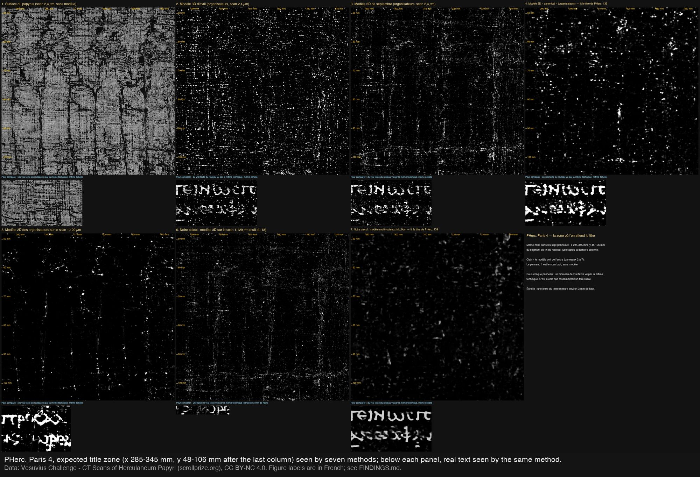
*Figure 1. The expected title zone seen by seven techniques, each with real text as a reference.*

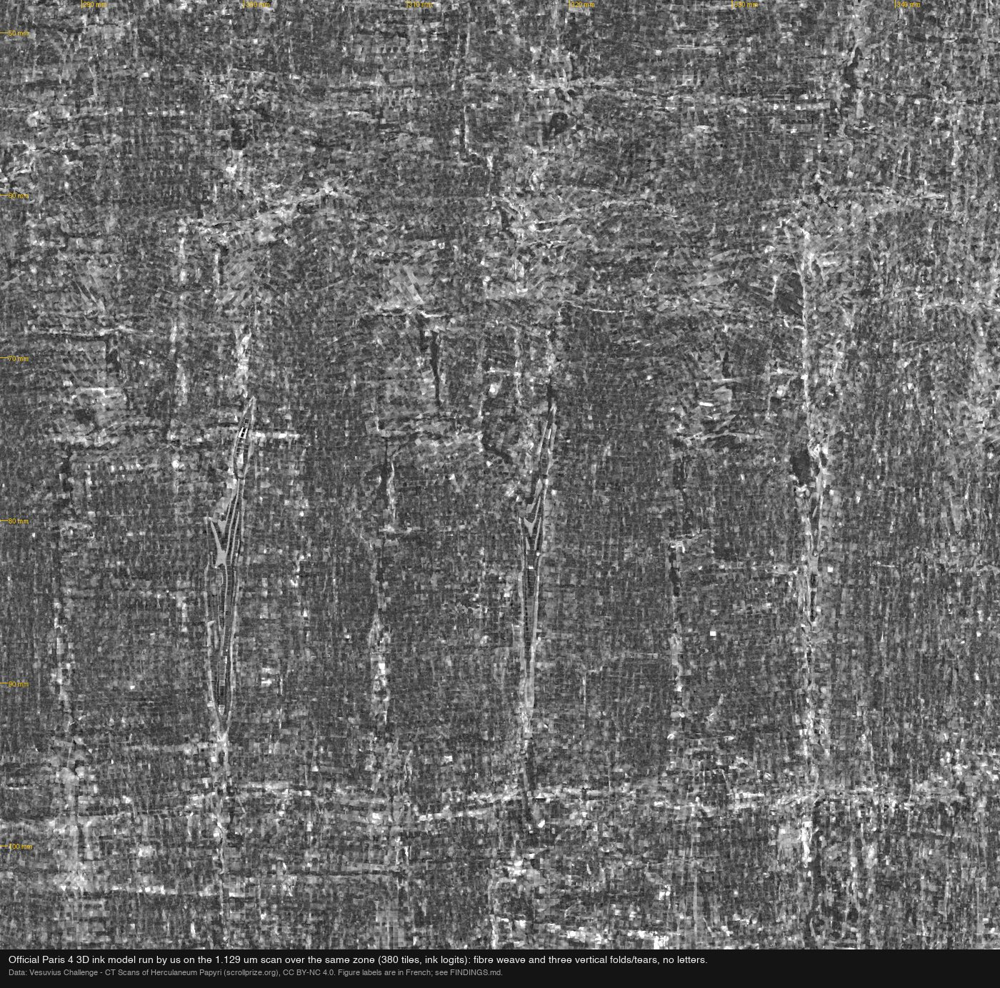
*Figure 2. The Paris 4 3D model run on the 1.129 µm scan over the central band of the blank zone.*

The last column of text spans x ≈ 217–280 mm (six lines in the edition, with a paragraphos
below); to its right the mesh continues for about 128 mm of blank papyrus, up to x = 408 mm near
the core. The blank zone covered by the mesh is 293 cm², of which 44 cm² faces text of the
adjacent wrap **[log, `detecteur_carte.py`]**.

Five families of ink maps were examined:

| # | Ink model | Scan | Computed by | Coverage of the blank zone |
|---|---|---|---|---|
| 1 | Paris 4 3D models, April (`ink3d-…-v3-78k-fullsup`) and September (`…-student-v12A-25000-…`) | 2.4 µm | organizers; projected by us in depth slices | all (293 cm²) |
| 2 | 2D "canonical" (`new_canon_autoresearch_recipe`), the model that reads the PHerc. 139 title | 2.4 µm | organizers | all (293 cm²) |
| 3 | 2D model on the twin segment `20260623141924-w010-027` | 1.129 µm | organizers | 149 cm² |
| 4 | Paris 4 3D model `ink_paris4_3d_4.8um_gambiarra` | 1.129 µm | us, `balayage.py` | x 285–345, y 48–106 mm (35 cm²) |
| 5 | Multi-scroll `ink_9um`, two checkpoints | 2.4 µm | us, `ink9.py` | 282 cm² (x 281–408 full height, and x 205–281 below the last column) |

Figure 1 (`figures/01_title_zone_seven_views.jpg`, from `comparaison_titre.py`) shows the most
likely window (x 285–345, y 48–106 mm) through all of them, each with a piece of real text seen
by the same method underneath. Figure 2 (`figures/02_scan1129_sweep.jpg`, from
`mosaique_balayage.py`) is family 4: fibre weave and three vertical folds or tears near x 299,
318 and 334 mm, no letters.

What was measured:

- **Ghost-free map** (family 1; `carte_fin_paris4.py`, `voisinage.py`,
  `carte_sans_fantomes.py`). In the text-free zone, pixels above the ink threshold: 6.0 % in a
  thick projection (±134 µm), 2.3 % within the sheet's own depth slice, 1.0 % after removing what
  the facing wrap explains; 40 residual clusters **[read back from the report the script
  saved]**. Looked at one by one (`planches_candidats.py`), they are folds, fibre weave and
  stains **[notes]**. Line periodicity at the 6.8 mm line spacing: at most 0.12, against 0.70 on text
  **[notes]**.
- **Pale-writing detector on published maps** (`detecteur_carte.py`; threshold = one false alarm
  per 1,000 blank windows; every window scored by a network that never saw it) **[log]**:

  | Family | Windows scored | Above threshold | Of which outside ghost zones | Expected by chance |
  |---|---|---|---|---|
  | 1 (two 3D models) | 18,859 | 136 | 21 | 16 |
  | 2 (canonical 2D) | 18,859 | 176 | 86 | 16 |
  | 3 (2D on 1.129 µm) | 8,535 | 33 | 9 | 7 |
  | 5 (`ink_9um`) | 17,510 | 244 | 17 | 15 |

  The windows above threshold inside ghost zones are real line ends and ghosts (section 3). The
  excess for the canonical map is round blobs along the borders of the mesh: of the 26 non-ghost
  windows among its 40 best, 23 lie within 10 mm of the top or bottom border or beyond
  x = 400 mm, and the other three are in the noisy last centimetres before the core
  **[recomputed from the saved candidate list]**. None of the best windows of any family looks
  like writing; this last judgment was made by eye on the contact sheets the script writes.
- **Detectors on our 1.129 µm sweep** (family 4) **[log]**: 9,500 windows of 1.5 mm, 10 above
  threshold for 10 expected by chance (`detecteur_pale.py`); 2,068 windows of 4.9 mm, 3 for 2
  expected (`detecteur_mosaique.py`). The best ones are tears, folds and fibre bands.
- **`ink_9um`** (family 5; `stabilite.py`) **[recomputed]**: fraction of surface with mean
  probability above 0.5: 0.32 % in the window x 285–345, y 48–106 mm and 0.66 % over the whole
  blank zone, against 14.6 % on the last column of text. After the stability test (section 6)
  0.03 % is left on x 345–408 mm, against 11.8 % on text.

Figure 3 (`figures/03_title_example_in_blank.jpg`, from `visionneuse_zone.py`) shows what was
being looked for: the PHerc. 139 title as `ink_9um` sees it, pasted into blank Paris 4 papyrus at
100, 50 and 25 % strength. It is a fabricated example and is labelled as such.

## 2. Sensitivity: what would have been seen, and what would not

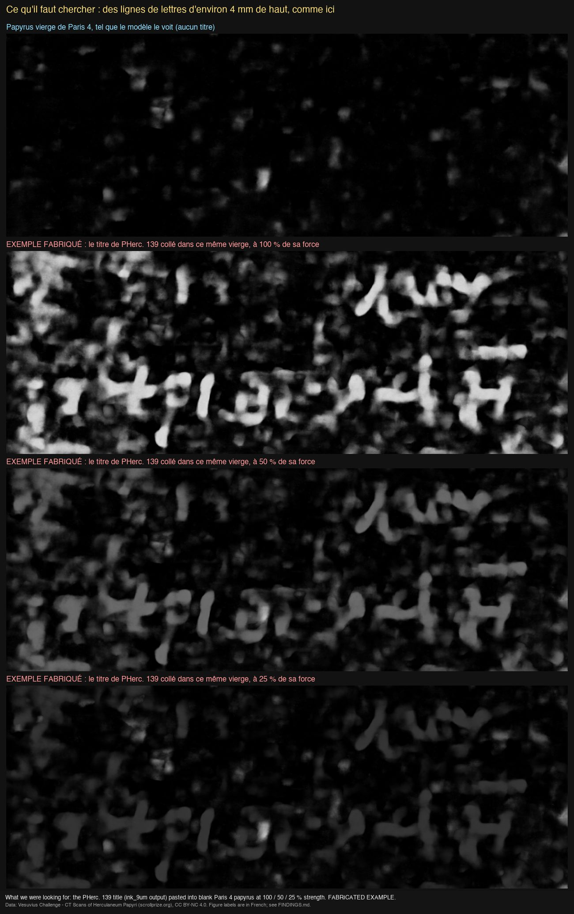
*Figure 3. A known title pasted into blank papyrus at 100, 50 and 25 % strength (montage).*

**Weakened real ink.** On a real line of Paris 4 (y ≈ 72 mm, x 176–195 mm) the excess density of
the ink was multiplied by a factor α in the raw scan and the Paris 4 3D model was run again
(`balayage.py etalon`, assembled by `assembler_etalon.py`). Share of the originally detected ink
pixels still detected **[recomputed]**:

| Ink contrast α | 60 % | 40 % | 25 % | 15 % | 0 % |
|---|---|---|---|---|---|
| 2.4 µm scan | 54 % | 32 % | 23 % | 20 % | 19 % |
| 1.129 µm scan | 61 % | 40 % | 31 % | 27 % | 25 % |

Median logit inside the ink on the 1.129 µm scan: +2.5 intact, −0.4 at 40 %, −1.2 at 0 %, for a
background at −3.4. Two caveats. Only ink that the model already sees can be weakened this way.
And a fifth to a quarter of the "erased" ink is still detected; widening the erased margin from
1 to 3 voxels gives 27 % instead of 25 %, so it is not badly masked ink. Either the model
responds to something other than density, or it reacts to the retouching itself. This is
unresolved.

**Detectors, direct test** (raw windows from the last third of the calibration line, which is
never used in training: the model's real response to weakened ink, not a superposition)
**[log]**:

| Detector | intact | 60 % | 40 % | 25 % | 15 % and 0 % |
|---|---|---|---|---|---|
| 1.5 mm windows, two networks | 100 % / 92 % | 80 % / 48 % | 29 % / 9 % | 2 % / 0 % | 0 % |
| 4.9 mm windows, two networks (5 bands only) | 100 % / 100 % | 100 % / 100 % | 0 % / 100 % | 0 % / 80 % | 0 % / 40 % at 15 %, 0 % at 0 % |

The two networks of the wide-window detector disagree, and five test bands are too few to settle
it. The numbers obtained by superimposing dimmed strokes on blank papyrus were far more
flattering (up to 84–100 % "detected" at 0 % contrast) and should not be quoted: a detector must
be checked on really weakened data.

That warning applies to the detector on published maps, whose sensitivity is only known from
superposition tests **[log]**: letters dimmed by 5.5 logits are still found in 97 % of windows
on the 3D maps; on the canonical map 96 % at −2.5 logits, 80–83 % at −3.5, 1 % at −4.5; on the
1.129 µm 2D map 95–96 % at −3.5, 0 % at −4.5; on `ink_9um` only 73–94 % of intact letters and
45–67 % at −7.

**Transfer to another ink.** The Paris 4 3D model does not reproduce the PHerc. 139 title:
agreement 0.42 and correlation 0.22 with the published 2D map (`etalonnage_139.py`) **[notes]**.
A model trained on the text of Paris 4 is therefore a poor witness for a title written in a
different ink, which is one of the hypotheses on the prize page ("possibly a different ink").
That is why families 2 and 5, which do read the PHerc. 139 title, matter more.

**Limits of the whole exercise.**

- The thin depth slice used for the ghost-free map recovers only 69 % of the certain text
  **[notes]**.
- Ink that none of these models detects is invisible to everything above.
- Our 1.129 µm sweep covers 35 cm²; the strips x 214–285 and x 345–408 mm on that scan were not
  run (about 840 tiles). That scan covers z ≈ 70–138 mm only.
- Not examined by us: the verso, the innermost half-wrap beyond the mesh (a core of about 1 mm
  radius, too small for a title **[notes]**), and any surface that the published mesh does not
  follow. The prize page says the top rows of the expected region are physically missing.

## 3. Two ghosts, read and matched to the edition

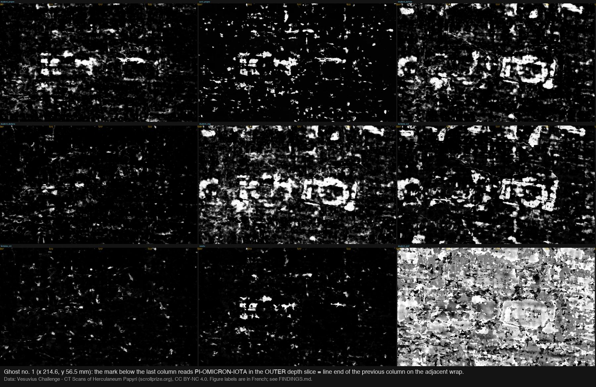
*Figure 4. The mark under the last column: in the outer depth slice it is the end of a published line.*

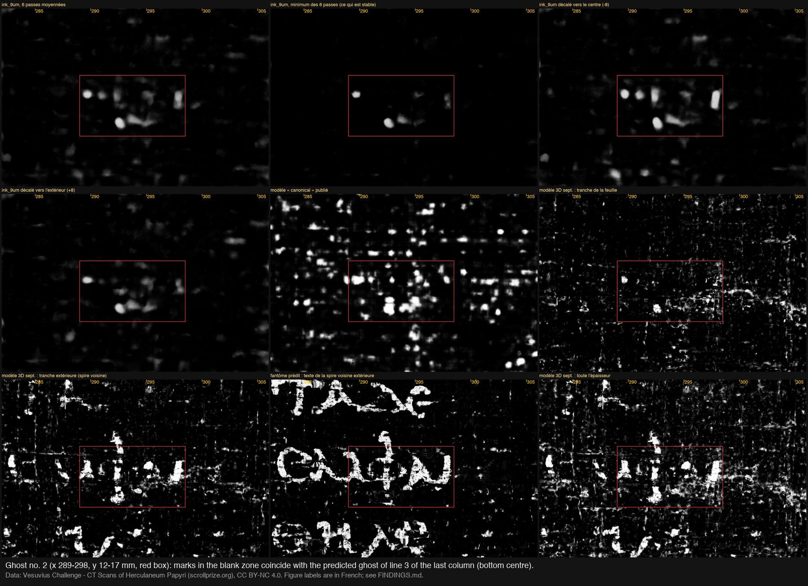
*Figure 5. A row of marks after the last column, and the predicted ghost of the facing wrap at the same place.*

In this compressed scroll adjacent wraps are about 0.1 mm apart. In a thick projection the ink
of the next wrap outward appears on top of the sheet. Along the mesh normal, with 9.6 µm voxels,
the ink of the sheet itself sits at t = −4…+3 and the ghosts at t ≥ +4, where t > 0 points
outward **[notes; orientation recomputed, section 5]**. `voisinage.py` finds, for every point,
the point of the adjacent wrap that faces it, so the ghost can be predicted from the text.

- **ΠΟΙ** at x 214.6, y 56.5 mm, below the last column. It is among the best windows of all
  four runs of the detector of section 1 **[log]**. In the outer depth slice it reads ΠΟΙ, the end of line 10 of the penultimate
  column: the edition has `ἀμφισβητήσεις ποι|οῦνται` there (col. 2, lines 10–11). The whole band
  x 202–223 mm carries such ghosts at every line. Figure 4 (`figures/04_ghost_poi.jpg`).
- **ΕΜΦΑΙ** at x 289–298, y 12–17 mm, in the blank zone. The predicted ghost of the outer wrap
  at that place is the end of line 3 of the last column: the edition has `κατέχειν, καὶ ἐμφαί|νοιθ’`
  (col. 1, lines 3–4). Figure 5 (`figures/05_ghost_emphai.jpg`): the marks of `ink_9um`, of the
  canonical map and of the 3D model's outer slice inside the red box coincide with the predicted
  ghost (bottom centre).

The Greek was checked against the DCLP record 989336 (see "Sources of the Greek text" at the
end) **[recomputed]**. The readings on the images are ours and were not checked by a papyrologist. Both figures were
composed interactively from the outputs of `carte_fin_paris4.py`, `voisinage.py`,
`carte_sans_fantomes.py` and `ink9.py`; the layout code was not saved as a script.

## 4. Vertical alignments are folds

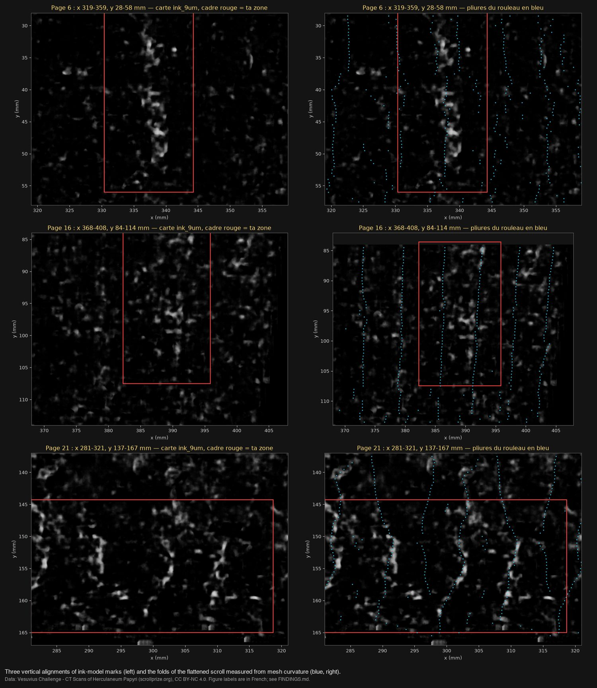
*Figure 6. Marks spotted by eye (red) and the folds of the flattened roll computed from the mesh (blue).*

The scroll is flattened: in cross-section it is an elongated loop of about 12 × 4 mm
**[notes]**, so the sheet is folded tightly twice per turn and
the papyrus is cracked there. Ink models put marks on these cracks, and once the sheet is
unrolled the marks line up vertically, like a column edge or a row of uprights.

`pliures.py` measures the curvature of the sheet on the mesh (3D curvature of each mesh row
after 0.25 mm smoothing; a fold is a local maximum above 1 mm⁻¹, i.e. a radius of curvature
under 1 mm) **[recomputed]**:

- 7.1 % of the sheet is above 1 mm⁻¹; the median is 0.20 mm⁻¹;
- a median of 38 folds per row over the 408 mm; spacing between neighbouring folds: median
  7.6 mm overall, 10–12 mm for x < 281 mm, 7.8 mm for x 281–345 mm, 5.1 mm for x 345–408 mm:
  the folds get closer towards the core, which is where an end title is expected.

Figure 6 (`figures/06_folds_vs_marks.jpg`): three zones that had been flagged by eye in the
`ink_9um` map because their marks line up (x 330–344, y 28–56 mm; x 382–396, y 84–107 mm;
x 281–319, y 144–165 mm), without and with the folds overlaid.
The figure was drawn during the session; `pliures.py` is a re-implementation written for this
repository. On the row y = 42 mm its curvature correlates at 0.91 with the session's curve, and
`pliures.py controle 337 42` reports a fold 0.5 mm from the alignment of the first zone. Not every mark on a
fold is a crack and not every crack is on a fold; the test only removes "it is vertically
aligned" as an argument for writing.

## 5. Winding direction and written side

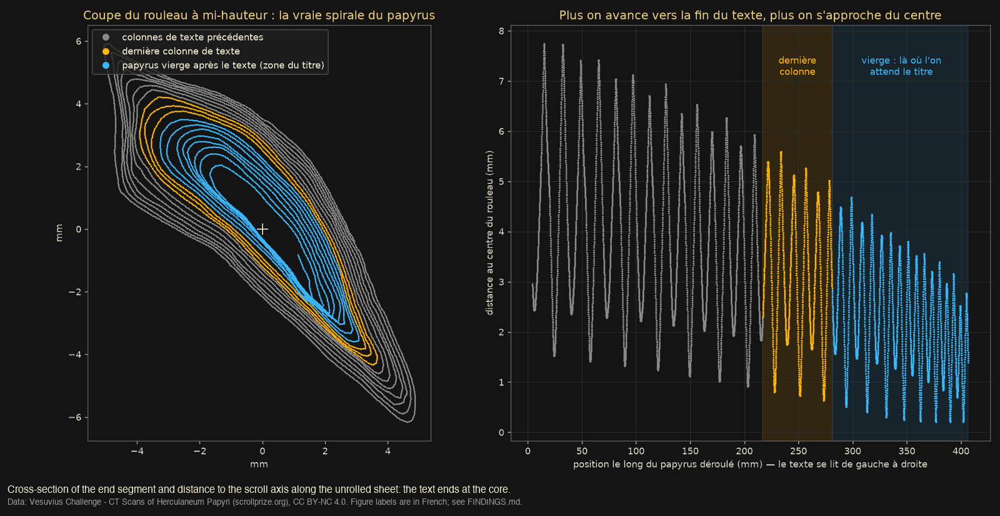
*Figure 7. The real spiral of the sheet at mid-height, and its distance to the centre along the roll.*

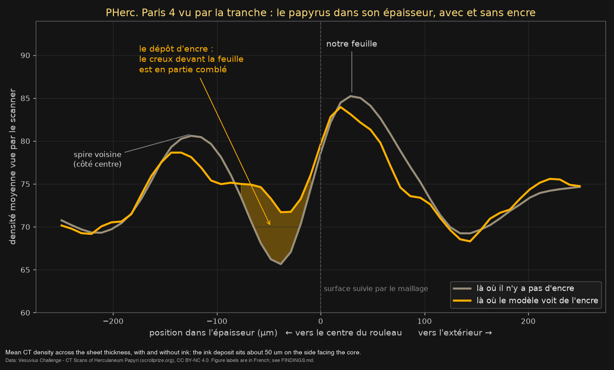
*Figure 8. The sheet seen edge-on, with and without ink: the ink deposit is on the side facing the centre.*

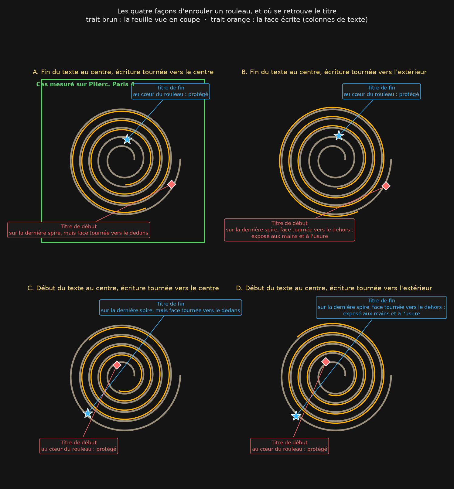
*Figure 14. The four ways of rolling a scroll and where a title ends up (labels in French); the green frame is the case measured here.*

`sens_enroulement.py` follows a mesh row in reading order and measures the distance to the
scroll axis **[recomputed, three heights y = 42, 84, 126 mm]**:

- mean distance to the axis: 4.5–5.2 mm over the first 50 mm of the segment, 1.6–1.9 mm over
  x 350–400 mm; 3.2–3.4 mm over the last column, 2.1–2.4 mm over the blank papyrus after it;
  slope −8 to −9 µm per mm of sheet. **The text ends at the core.**
- the mesh normal (the t > 0 of all our projections) points away from the axis on 93–100 % of
  the nodes.

`relief.py` measures the mean CT density across the thickness of the sheet, with and without
ink: the gap in front of the sheet on the t < 0 side is partly filled where the model sees ink
(mean density 72 against 66 **[notes]**), about 50 µm from the surface. **The written side faces
the core.** Figure 7 (`figures/07_winding_direction.png`) and figure 8
(`figures/08_sheet_profile_ink_side.png`), both drawn during the session.

Consequence: an end title would be on the last wraps around the core, written on the inner face,
which is the zone searched above. The prize page illustrates such an end title with the
physically opened PHerc. 1050, which the DCLP records as Philodemus, *On Death* IV, with end
title. A title at the beginning would be on the outermost wrap, at
the other end of the scroll (section 8). The axis is taken parallel to the z axis of the scan
(z varies by 2.6–3.5 mm along a row), which is an approximation.

As a per-pixel ink detector the relief is useless at this resolution: AUC 0.53 at 9.6 µm
**[notes]**; it was not redone at native resolution.

## 6. Three tests for any candidate

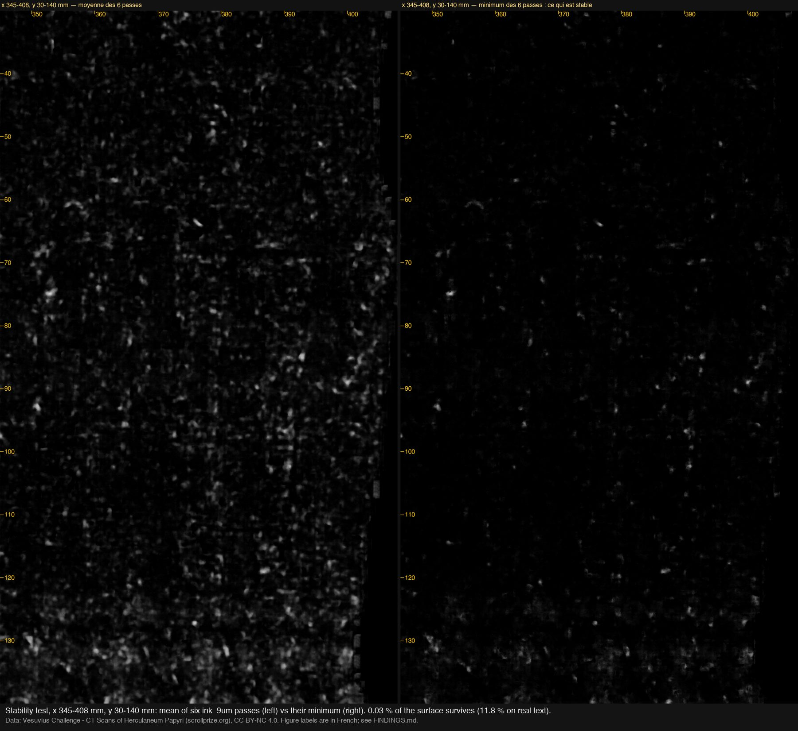
*Figure 9. Stability map: what remains when only pixels marked in all six passes are kept.*

Before a mark in a blank zone is called writing:

1. **Facing wrap** (`voisinage.py`, `carte_sans_fantomes.py`): does the adjacent wrap carry text
   at the facing position, and does the mark sit in the outer depth slice? If so it is a ghost.
2. **Fold** (`pliures.py controle X Y`): does it sit on a fold of the flattened scroll?
3. **Stability** (`stabilite.py`): does it survive when the model is run again with another
   checkpoint and other depth windows? `ink_9um` was run with two checkpoints at three depth
   offsets (−8, 0, +8 layers of 2.4 µm); a pixel is stable if its probability is above 0.5 in
   all six maps **[recomputed]**:

   | Zone | Mean > 0.5 | Stable | Agreement between checkpoints (r) |
   |---|---|---|---|
   | Known text (last column, 40 × 35 mm) | 14.6 % | 11.8 % | 0.95–0.96 |
   | Blank zone near the core (x 345–408, y 30–140 mm) | 0.37 % | 0.03 % (169 specks, largest 0.35 mm²) | 0.42–0.44 |
   | A blank box used as control (21 × 30 mm) | 0.70 % | 0.06 % | 0.39–0.49 |
   | Zone containing the ΕΜΦΑΙ ghost (16 × 24 mm) | 0.72 % | 0.27 % | 0.60–0.78 |
   | Three other zones flagged by eye, with vertical alignments of marks | 0.7–2.1 % | 0.15–0.69 % | 0.39–0.66 |

   Figure 9 (`figures/09_stability_map.jpg`). Restricted to the ghost itself, the session notes
   give an agreement of 0.82 **[notes]**, and 0.5–0.7 for marks on folds. Ghosts are real ink,
   so they are fairly stable: only test 1 removes them. `ink_9um` outputs about 0.25 for
   "no ink" and 0.75 for "ink" (section 7), so 0.5 is its midpoint.

These tests do not replace the false-positive checks the title prize asks for (held-out
validation, no overlap with training data); they are cheap filters to apply first.

## 7. `ink_9um` on a MacBook

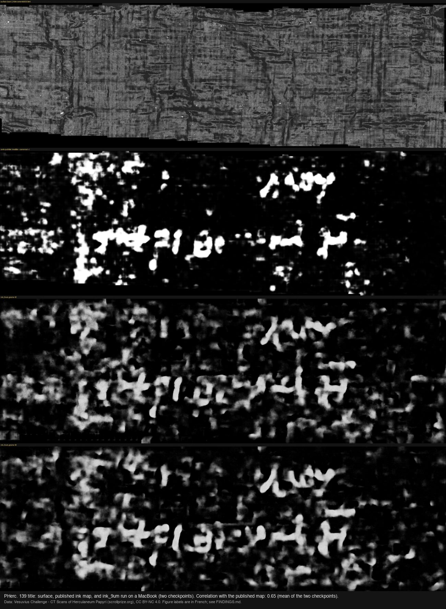
*Figure 10. The PHerc. 139 title: raw scan, published map, our run.*

*Figure 11. Known text of Paris 4 read by `ink_9um` at three depth offsets.*

`ink9.py` follows the official inference code (ScrollPrize/villa, branch `merge-ink-pipelines`):
level 2 of a 2.4 µm surface volume, the 84 central layers averaged by 4 into 21 layers at
9.6 µm, 128 × 128 windows with stride 64, robust normalisation per window, Hann blending. The
script of that branch runs on CUDA or falls back to CPU. Correction (13 Nov 2026): the current
official inference in `main` (`vesuvius.ink_detection.inference.infer`) already runs on Apple
GPUs (PR #1865, merged 8 Oct 2026; `--device` option in PR #2160), so MPS support is not something
this repository adds. What `ink9.py` adds is practical: a window given in millimetres and read
straight from the bucket, tile-by-tile processing with resume, checkpoints loaded with
`weights_only=True`, and passes at several depth offsets for the stability test of section 6.

What the model card (<https://huggingface.co/scrollprize/ink_9um>, read on 13 November 2026)
says and that matters here: the model was trained on four scrolls, PHerc. 139, Scroll 1667,
PHerc. Paris. 4 (8 segments) and PHerc. 814; and because of label smoothing its most confident
"no ink" output is near 0.25, not 0. We did not look up which segments were used for training
(they are listed in the `ink_9um` dataset), so **the two tests below are sanity checks of the
port, possibly on training regions, not held-out validation.**

- **PHerc. 139 title** (`ink9.py titre139`, `accord_titre139.py`) **[recomputed]**: correlation
  with the published ink map 0.59 and 0.62 for the two checkpoints, 0.65 for their mean; 0.73
  between the two checkpoints. The title is legible in our output (we read `…ΜΟΥ / ΠΕΡΙ ΘΕΩΝ Η`,
  as published).
  Figure 10 (`figures/10_pherc139_title_ink9.jpg`). PHerc. 139 is the main training scroll of
  `ink_9um`.
- **Paris 4, last column** (`ink9.py paris4 p4_texte 5 45 215 250 -8,0,8`) **[recomputed]**: the
  two checkpoints agree at r = 0.96 and the lines are legible. Figure 11
  (`figures/11_paris4_text_ink9.jpg`).
- Cost: about one minute per 2048 × 2048 px tile (19.7 mm square) for two checkpoints, a third
  of it download **[log]**.

## 8. Before and after on segment w126-127

*Figure 12. Published 2D map (top) and `ink_9um` on the laptop (bottom) at the same place.*

In the "book" viewer (`visionneuse_livre.py`) two lines of letters were spotted by eye near the
outer end of the scroll. Located through the 3D geometry: segment `20260701183150-w126-127`,
x ≈ 93–128 mm, y ≈ 97–119 mm of that segment. Figure 12 (`figures/12_w126_before_after.jpg`):
the published 2D canonical map shows blobs there; `ink_9um` run with
`ink9.py segment p4_debut PHercParis4/segments/20260701183150-w126-127/surface-volumes/2.4um-0.22m-78keV-volume-20260411134726.zarr Y0 Y1 X0 X1`
gives clean letters 2–4 mm tall on lines 7 mm apart.

What this is and is not:

- It is not a new reading: the organizers' published 3D ink prediction shows the same letters.
  The point is that the multi-scroll model on a laptop gives a legible image where the published
  2D map does not. Paris 4 is a training scroll of `ink_9um` and we did not check whether this
  segment was used.
- It is running text, not a title, and not the first page: text continues on the wraps further
  out (x ≈ 700–1100 mm of the full-scroll map), which are heavily damaged, with holes repeating
  every ~310 mm. The beginning of the work, and a possible initial title, are probably lost;
  that last sentence is an inference, not a measurement.
- The window processed was 48 × 62 mm around that place; its exact bounds were not logged.
- Lesson: to find a place of one map in another segment, go through the 3D position (nearest
  mesh node), not through image correlation, which sent us to an empty zone first.

## 9. Census of published segments, for First Letters

`recenser_segments.py` reads the public `metadata.min.json` and the Zarr headers:
`catalogue/segments.csv` has 710 rows for 324 segments of 14 samples **[recomputed]**. Crossed
with the 20 scroll volumes listed as eligible for First Letters on the prize page (as copied on
12 November 2026 into `catalogue/statut_lecture.csv`):

- **only PHerc. 800 has published segments**: six auto-grown patches of 0.7 to 5.0 cm² (8.5 to
  22 mm on a side), each with a 31-layer surface volume at 8.64 µm, and no published ink map;
- the other 19 have none, so any work on them starts with segmentation.

A first pass of `ink_9um` on those six patches (`ink9_pherc800.sh`: two checkpoints, three depth
offsets) shows nothing legible: 0.9–3.9 % of pixels above 0.5 **[log]**, agreement between
checkpoints 0.21–0.51 **[notes]**, against 0.96 on real text. The other twelve checkpoints of
`ink_9um` were not tried at the time of writing.

## 10. Blind automatic reading in the book viewer (experimental)

`lecture_livre.py` gives each page of the book viewer to a language model as smoothed strips with
millimetre rulers; the model returns a line-by-line reading (capital = sure, lower case =
uncertain, dot = illegible) without access to any edition. Measured on two columns that are
already published (`lecture_livre.py noter`, file `lectures/temoins.json`, not distributed):

| Control column | Letters of the edition recovered | "Sure" letters that are right | "Uncertain" letters that are right |
|---|---|---|---|
| col. −8 (241 letters) | 50 % | 75 % (65 letters) | 56 % (128 letters) |
| col. −6 (268 letters) | 56 % | 92 % (75 letters) | 63 % (127 letters) |

On pages without an edition the run (44 pages read out of 138 before it was stopped) gave
isolated letters and three sure word sequences, nothing that can be translated. Those readings are
kept out of this repository on purpose (see "Data terms"). Two control columns are a small
sample, and the reader may know the published text from elsewhere; the figures are an upper
bound, not a validation.

## 11. Other things that did not work

All **[notes]** unless stated; the scripts are included.

- **Template matching** (`recherche_mot.py`): a ΠΕΡΙ template cut from the last column finds the
  other known ΠΕΡΙ as its best score in the text; in the blank zone outside the ghost band the
  best score is 0.125, against 0.24–0.31 on real text. By injection, real text is recovered down
  to 50 % of its normal amplitude and lost below 25 %.
- **Dual energy** (`double_energie.py`, `contraste_energies.py`): the 137 keV scan covers only
  y ≈ 61–82 mm; on two blocks of text the ink contrast ratio 137/78 keV is 0.95 and 0.72, with
  no clear spectral signature (and biased, since the ink voxels are chosen by a model trained on
  the 78 keV scan).
- **Model-free detection** on the raw scan (bright bump at the surface): AUC 0.55.
- **Text overlap** (`recherche_texte.py`) **[recomputed]**: the 4,100 letters of the edition
  share no passage with 2,115 other literary papyri of the DCLP; the best "alignments" are
  43–49 scattered letters of unrelated sentences.
- **Vocabulary neighbours** (`voisins_bibliotheque.py`) **[recomputed]**: among 88 Herculaneum
  papyri of the DCLP (median cosine with Paris 4: 0.024), the three closest are, with the
  identification given by the "overview" field of each DCLP record:
  - PHerc. 225, 411, 424, 1094, 1497, 1572, 1575, 1576, 1578, 1583 (0.065; shared stems: food,
    flavours, music, pleasure, astonishment): Philodemus, *On Music* IV. The record notes that
    this roll has a double end title and a title at the beginning;
  - PHerc. 425, 1079, 1086, 1580, 1674 (0.054): Philodemus, *On Rhetoric*, with end title. The
    record gives no book number; the literature assigns PHerc. 1674 to book II, which we did not
    check;
  - PHerc. 444, 460, 466, 1073, 1074, 1081 (0.052): Philodemus, *On Poems* I.

  This says the subject and the vocabulary are close to Philodemus' aesthetic works, not that
  Paris 4 is one of them; the similarities are low in absolute terms.

## What was not verified

- No papyrologist has looked at the ghost readings, nor at any figure.
- The GPU scripts (`ink9.py`, `balayage.py`, the detectors' training) were **not rerun** for
  this write-up; their numbers come from the run logs and stored outputs of the original runs.
  The scripts added while writing (`stabilite.py`, `pliures.py`, `sens_enroulement.py`,
  `accord_titre139.py`, `assembler_etalon.py`, `transfos.py`, `preparer.py`) were run on CPU
  against those stored outputs and reproduce the session's numbers.
- The repository was never run end to end from a clean clone. All scripts compile and their
  imports resolve; the download helper was exercised on the small PHerc. 139 mesh only.
- Figures 4 to 12 were composed interactively; the scripts give the same data, not the same
  layout.
- Numbers tagged **[notes]**.
- Which Paris 4 and PHerc. 139 segments were in the training data of `ink_9um`, and therefore
  whether the regions shown in sections 7 and 8 are training regions.
- Whether an `ink_9um` map of segment 701 had already been published: we found none in the
  bucket listing of the segment, and did not ask.
- We did not compare our maps pixel by pixel with those of the prior work below.
- `catalogue/statut_lecture.csv` reflects the prize page of 12 November 2026.
- We consulted neither of the two articles behind the DCLP record, only its encoding; we do not
  know which of them prints the sixteen columns (see below).

## Prior work

"PHerc. Paris 4: complete recto/verso maps and a thirteen-depth atlas of the title region",
posted in the show-and-tell channel of the Vesuvius Challenge Discord on 11 September 2026:
<https://gitlab.com/yohanntschudi/phercparis4-depth-echoes>. It reads the end of Paris 4 at
thirteen depths, recto and verso, finds no legible title, and identifies the "letters" after the
last columns as echoes of line ends one wrap away. Our facing-wrap result agrees with it. What we
add: the two ghosts read and matched to the edition, the sensitivity measurements, the fold and
stability tests, the 1.129 µm sweep with the 3D model, and `ink_9um` over the whole blank zone.

## Data

Scans, segments, meshes and published ink predictions: *Vesuvius Challenge - CT Scans of
Herculaneum Papyri* (Angelotti, Parsons, Johnson, Dal Prà, Rudolph, Tafforeau, Mirone,
Henderson, Schilling, McDonald, Josey, Nader, Parker, Seales), Vesuvius Challenge, CC BY-NC 4.0.

## Data terms

The [data page of PHerc. Paris. 4](https://scrollprize.org/data_browser/PHercParis4) carries a
publication notice: until 25 June 2027, users "may not publish scholarly claims, transcriptions,
translations, editions, interpretations, or formal analyses based on the data" without permission.
This document is a technical report on ink-detection tooling. It gives no transcription or
translation of unpublished parts of the scroll; section 8 describes letters without reading them.
The Greek quoted is the published text of the last sixteen columns, and the two ghosts of section 3
are letters of those published lines.

## Sources of the Greek text

All Greek quoted here comes from the record 989336 of the Digital Corpus of Literary Papyri
(<https://github.com/papyri/idp.data>, `DCLP/989/989336.xml`; © DCLP and LDAB, CC BY 3.0;
digitally edited by Johannes Kern and revised by Holger Essler, Würzburg), which encodes sixteen
columns numbered from the end. Its bibliography points to two publications (papyri.info
bibliography records 97350 and 97351):

- as principal publication: F. Nicolardi, S. Parsons, D. Delattre, G. Del Mastro, R. L. Fowler,
  R. Janko, T. Reinhardt, C. S. Parker, C. Chapman and W. B. Seales, "Revealing Text from a
  Still-rolled Herculaneum Papyrus Scroll (PHerc.Paris. 4)", *Zeitschrift für Papyrologie und
  Epigraphik* 229 (2024), pp. 1–13;
- as principal reference: F. Nicolardi, D. Delattre, G. Del Mastro, R. Fowler and R. Janko, "The
  Final Columns of PHerc. Paris 4 Revealed Through Virtual Unwrapping", *Cronache Ercolanesi* 54
  (2024), pp. 9–27.

The record does not say which of the two prints the sixteen columns. Its apparatus credits
individual readings to the five authors of the second article, and its only printed reference
string (for the illustrations) is "ZPE 229 (2024), p. 1-13 fig. 1-12". Where this document says
"the edition", it means the DCLP record.
